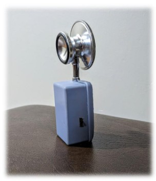
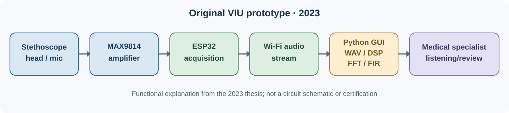
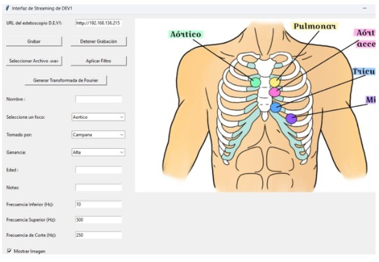

# Electronic Stethoscope | Biomedical Instrumentation Research

**Master's thesis · Universidad Internacional de Valencia (VIU) · 2022–2023**\
**Researcher:** Renán Andrés Espinar Saavedra · La Paz, Bolivia\
**Thesis director:** Dr. Aldo Eleazar Pérez Ramos\
**Defense period stated in the manuscript:** 20–24 November 2023

> A working experimental system for the acquisition, wireless transmission, digital processing and recording of cardiac sounds. **Research prototype only; not a certified clinical device or automated diagnostic system.**

*Original physical prototype. Figure 3.15, page 30 of the 2023 VIU thesis.*

## Project

**Original title:** *Diseño de un prototipo de sistema de estetoscopio electrónico para digitalizar y procesar sonidos cardíacos.*

This research integrated a conventional stethoscope chestpiece with electronic signal acquisition, an ESP32-based Wi-Fi stream, and a Python desktop application for listening, WAV recording, digital filtering, and spectral inspection. A custom mechanical enclosure was built and documented with CAD drawings.

The historical project was developed during academic year **2022–2023**, with a defense period in November 2023. The existing repository slug still says **2024**; that legacy name should not be interpreted as the thesis year.

## System architecture

| Stage | Documented technology | Manuscript |
|---|---|---|
| Acoustic pickup / gain | Stethoscope head, microphone transducer and **MAX9814** amplifier | pp. 18–20, 29–30 |
| Embedded acquisition | **ESP32**, Arduino Audio Tools / AudioWAVServer | pp. 22–24, Annex A |
| Wireless connection | Wi-Fi audio stream to a computer | pp. 20–25 |
| Desktop software | **Python**, Tkinter GUI, PyAudio, NumPy, SciPy and WAV handling | pp. 25–27, 31–34, Annex B |
| DSP | Spectral visualization; real-time frequency filtering; **FIR band-pass filtering** of saved WAV | pp. 25–28, 33–34 |
| Mechanical design | Custom housing, reported as 3D printed by **SLS** | pp. 29–30, 58–59 |

The original hardware and software architecture are documented in the research manuscript. The firmware and Python source code are maintained privately.

## Gallery

| Physical prototype | Enclosure CAD |
|---|---|
|  |  |

| CAD assembly | Original Python interface |
|---|---|
|  |  |

*The photographs and figures above come from the author's thesis: pages 29, 30 and 34. Patient photographs are deliberately excluded. Figures may retain university formatting or other third-party imagery; attribution/publication rights should be reviewed before reuse outside this documentation.*

## Clinical Evaluation and Medical Documentation (2023)

### Hospital de Clinicas - La Paz, Bolivia

The electronic stethoscope was evaluated using five cardiac sound recordings obtained at Hospital de Clinicas, La Paz, Bolivia, during the original research project.

The prototype enabled the acquisition, wireless transmission, recording, playback and digital processing of cardiac acoustic signals.

The recordings were evaluated by medical specialists.

The researcher maintains signed medical diagnostic certificates supporting the clinical findings documented during the evaluation.

### Hospital Authorization

The researcher confirms possession of signed hospital documentation expressly authorizing publication of the research sound recordings.

The signed authorization and medical diagnostic certificates are retained in the original research records.

Patient-identifying documentation is not included in this public engineering repository.

### Clinical Findings

Clinical findings and diagnoses were established by medical professionals.

The electronic stethoscope provided acoustic acquisition and signal-processing capabilities. It was not an automated diagnostic classifier.

The original research documented functional operation of the prototype and its evaluation using clinical recordings.

The evaluation involved five recordings and was not designed to establish statistical diagnostic sensitivity, specificity or regulatory medical-device certification.

### Research Recordings

Two WAV recordings are available in the [samples directory](samples/).

These recordings are published as part of the engineering research documentation, under the publication authorization reported by the researcher.

The audio is presented for acoustic inspection and engineering analysis. Patient names and individual medical certificates are not published.

For additional information, see:

- [Clinical documentation](docs/CLINICAL_BACKGROUND.md)
- [Research publication record](docs/PUBLICATION_CHECKLIST.md)
- [Research recordings](samples/README.md)

## Separate 2026 continuation

The follow-on research investigates a **single modular digital stethoscope prototype** using reversible acoustic coupling to a Littmann Classic III head, a low-noise electret transducer and an ESP32-S3 platform. Its planned WAV acquisition and Wi-Fi features require **their own testing and validation**; the 2023 patient experience does not validate the new hardware.

See [current research](docs/CURRENT_RESEARCH.md).

## Technical documentation

- [2023 thesis: source-grounded technical record](docs/THESIS_2023.md)
- [Clinical assessment and medical documentation](docs/CLINICAL_BACKGROUND.md)
- [2026 redesign and verification plan](docs/CURRENT_RESEARCH.md)
- [Research publication documentation](docs/PUBLICATION_CHECKLIST.md)
- [Origin and use of thesis figures](docs/FIGURE_GUIDE.md)
- [Resumen en español](docs/RESUMEN_ES.md)

## Software Availability

The original research includes an embedded acquisition system and a Python desktop application.

The firmware and application source code are maintained privately.

This public repository presents the technical architecture, physical prototype, engineering documentation, experimental evaluation and authorized research recordings.

The project is an experimental biomedical instrumentation system, not a commercially certified medical device.

## Researcher

**Renán Andrés Espinar Saavedra**\
Licenciado en Ingeniería Mecatrónica · Máster Universitario en Ingeniería Biomédica\
Coordinador de Investigación de Tecnología e Informática — Universidad del Valle (UNIVALLE), Bolivia\
[GitHub](https://github.com/RenanEspinar) · [ORCID 0009-0007-1918-7177](https://orcid.org/0009-0007-1918-7177)

**Suggested academic reference:** Espinar Saavedra, R. A. (2023). *Diseño de un prototipo de sistema de estetoscopio electrónico para digitalizar y procesar sonidos cardíacos* [Unpublished master's thesis, Universidad Internacional de Valencia].
