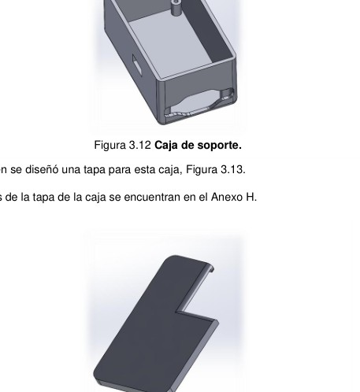
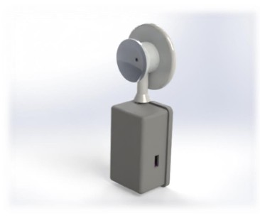

# Electronic Stethoscope | Biomedical Instrumentation Research

**Master's thesis · Universidad Internacional de Valencia (VIU) · 2022–2023**\
**Researcher:** Renán Andrés Espinar Saavedra · La Paz, Bolivia\
**Thesis director:** Dr. Aldo Eleazar Pérez Ramos\
**Defense period stated in the manuscript:** 20–24 November 2023

> A working experimental system for the acquisition, wireless transmission, digital processing and recording of cardiac sounds. **Research prototype only; not a certified clinical device or automated diagnostic system.**

*Original physical prototype. Figure 3.15, page 30 of the 2023 VIU thesis.*

## Project

**Original title:** *Diseño de un prototipo de sistema de estetoscopio electrónico para digitalizar y procesar sonidos cardíacos.*

This research integrated a conventional stethoscope chestpiece with electronic signal acquisition, an ESP32-based Wi-Fi stream, and a Python desktop application for listening, WAV recording, digital filtering, and spectral inspection. A custom mechanical enclosure was built and documented with CAD drawings.

The historical project was developed during academic year **2022–2023**, with a defense period in November 2023. The existing repository slug still says **2024**; that legacy name should not be interpreted as the thesis year.

## System architecture

| Stage | Documented technology | Manuscript |
|---|---|---|
| Acoustic pickup / gain | Stethoscope head, microphone transducer and **MAX9814** amplifier | pp. 18–20, 29–30 |
| Embedded acquisition | **ESP32**, Arduino Audio Tools / AudioWAVServer | pp. 22–24, Annex A |
| Wireless connection | Wi-Fi audio stream to a computer | pp. 20–25 |
| Desktop software | **Python**, Tkinter GUI, PyAudio, NumPy, SciPy and WAV handling | pp. 25–27, 31–34, Annex B |
| DSP | Spectral visualization; real-time frequency filtering; **FIR band-pass filtering** of saved WAV | pp. 25–28, 33–34 |
| Mechanical design | Custom housing, reported as 3D printed by **SLS** | pp. 29–30, 58–59 |

The implementation is described as reported in the thesis; the original source code has **not** been independently retested against current software libraries.

## Gallery

| Physical prototype | Enclosure CAD |
|---|---|
|  |  |

| CAD assembly | Original Python interface |
|---|---|
|  |  |

*The photographs and figures above come from the author's thesis: pages 29, 30 and 34. Patient photographs are deliberately excluded. Figures may retain university formatting or other third-party imagery; attribution/publication rights should be reviewed before reuse outside this documentation.*

## Experimental assessment (2023)

The thesis reports exploratory use at the **Hospital de Clínicas, La Paz, Bolivia**, with **five patient sound recordings** reviewed by a medical specialist (pp. 35–39). Reported observations included both regular and atypical auscultatory features. The author documented signal acquisition, listening, recording, and filtering, together with qualitative feedback.

**What the study does not establish:** no clinical sensitivity/specificity, adequately powered controlled comparison, ECG-based validation of all findings, AI-driven diagnosis or regulatory approval is demonstrated in the thesis. Reported auscultatory findings should not be presented as machine-confirmed diagnoses.

Images of patients appear in the thesis (p. 35), but **are not included here**. The academic-recording consent form included in the thesis is **not evidence of consent to unlimited public online distribution**.

## Public WAV files: permissions review

This repository previously contained two linked WAV recordings. Their source and authorization for **public redistribution** remain unverified. This README intentionally does not promote individual listening links or associate audio with patient diagnoses. Note that removing a link does not remove existing files or Git history. See [publication checklist](docs/PUBLICATION_CHECKLIST.md) and [audio policy](samples/README.md).

## Separate 2026 continuation

The follow-on research investigates a **single modular digital stethoscope prototype** using reversible acoustic coupling to a Littmann Classic III head, a low-noise electret transducer and an ESP32-S3 platform. Its planned WAV acquisition and Wi-Fi features require **their own testing and validation**; the 2023 patient experience does not validate the new hardware.

See [current research](docs/CURRENT_RESEARCH.md).

## Technical documentation

- [2023 thesis: source-grounded technical record](docs/THESIS_2023.md)
- [Clinical evidence and limitations](docs/CLINICAL_BACKGROUND.md)
- [2026 redesign and verification plan](docs/CURRENT_RESEARCH.md)
- [Public-release and data-protection checklist](docs/PUBLICATION_CHECKLIST.md)
- [Origin and use of thesis figures](docs/FIGURE_GUIDE.md)
- [Resumen en español](docs/RESUMEN_ES.md)

## Research and software scope

The thesis contains historical firmware and Python code in annexes, including obsolete network settings. **This repository is not a ready-to-run clinical software release.** Before any source release, credentials must be removed, dependencies pinned, DSP routines checked, and the full acquisition chain tested. No source-code license is implied by this documentation.

## Researcher

**Renán Andrés Espinar Saavedra**\
Licenciado en Ingeniería Mecatrónica · Máster Universitario en Ingeniería Biomédica\
Coordinador de Investigación de Tecnología e Informática — Universidad del Valle (UNIVALLE), Bolivia\
[GitHub](https://github.com/RenanEspinar) · [ORCID 0009-0007-1918-7177](https://orcid.org/0009-0007-1918-7177)

**Suggested academic reference:** Espinar Saavedra, R. A. (2023). *Diseño de un prototipo de sistema de estetoscopio electrónico para digitalizar y procesar sonidos cardíacos* [Unpublished master's thesis, Universidad Internacional de Valencia].
